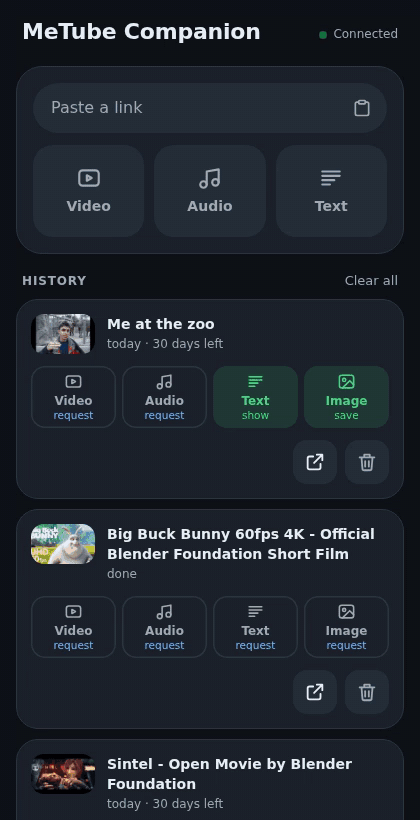
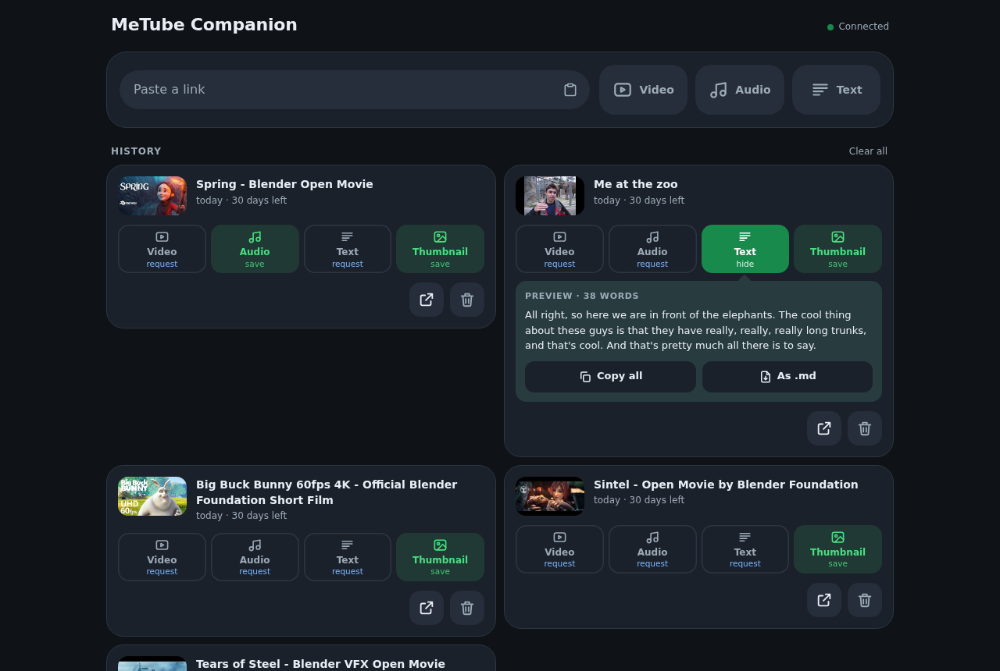
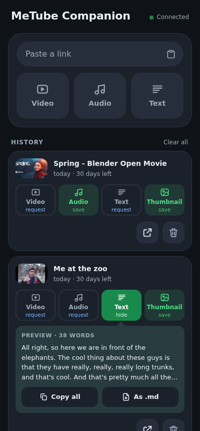
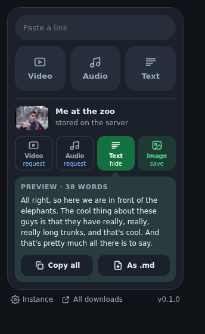

# MeTube Companion

> **Installing with an AI assistant?** Give it the link to this repository and ask it to follow [INSTALL.md](INSTALL.md). It explains what MeTube Companion is and walks through every decision (where to run it, automatic deletion, cookies, updates).

A friendlier web UI and browser extension for [MeTube](https://github.com/alexta69/metube), the self-hosted web UI for yt-dlp. It runs next to a stock MeTube instance and does not modify it.

<p align="center"></p>

<p align="center"><a href="docs/demo.mp4">Watch the 71 s demo (MP4, 5.0 MB): extension, web UI, phone</a></p>

## What it does

- **One link, four formats.** Paste a link and pick Video, Audio or Text (transcript); the thumbnail is one tap away on the video's card. One tap sends; tap the same tile again within 5 seconds to cancel (an accidental tap costs no server time).
- **One card per video.** The history shows every video once, with all formats side by side: *save* what is there, *request* what is missing, and watch progress right inside the cell.
- **Transcripts that just work.** Detects whether a YouTube video is spoken in English or German (including AI-dubbed videos), fetches the original caption track to dodge YouTube's 429 errors, and turns captions into clean text. Preview, copy, or save as Markdown.
- **Browser extension** for Chromium ([Chrome Web Store](https://chromewebstore.google.com/detail/jbbofgfomolpmigffpdnmodnelcagelp)) and Firefox. Sends the current tab, optionally with the cookies of that site (YouTube, Instagram, TikTok) for signed-in content, shows the same format cells, and notifies you when a download is done.
- **Optional download settings.** Pick the video quality (down to 480p) and the audio format (MP3, Opus) once; the tiles keep working with one tap.
- **Installable on Android**, with a share target: share a link from the YouTube app straight to your instance.
- **Housekeeping.** Shows how long files stay before automatic cleanup (optional), deletes all formats of a video at once (into a trash, restorable for a few days), clears the whole history with or without files.
- **Report problems** straight from a failed download: opens a prefilled GitHub issue.

## Screenshots

| Desktop | Phone | Browser extension |
|---|---|---|
|  |  |  |

Demo content: Blender open movies and "Me at the zoo".

## Quick start

**On your own computer** (Docker Desktop on Windows/macOS, Docker on Linux): MeTube and the companion together, reachable only from this computer.

```sh
mkdir metube-companion
cd metube-companion
curl -O https://raw.githubusercontent.com/falkloewert/metube-companion/main/compose.desktop.yml
docker compose -f compose.desktop.yml up -d
# open http://localhost:8081
```

Windows PowerShell: type `curl.exe` instead of `curl`. Downloads go to `./downloads` inside that folder (set `METUBE_DOWNLOADS` to change it). MeTube updates yt-dlp at start and every day at 12:00 (time zone `TZ`, default UTC), so YouTube changes are picked up automatically. On Linux set `PUID`/`PGID` to your user (`id`) in a file `.env` next to the compose file.

**Next to an existing MeTube** (server, NAS): copy the `companion` service from [`compose.server.yml`](compose.server.yml) into the compose file that runs MeTube, add the four required MeTube settings marked there, and open `http://<server>:8082`.

### Configuration

| Variable | Default | Meaning |
|---|---|---|
| `METUBE_URL` | `http://metube:8081` | Where the companion reaches MeTube |
| `RETENTION_DAYS` | `0` | Delete files in the download folder older than this many days (0 = never; hidden folders such as MeTube's `.metube` state are skipped); the UI shows the days left |
| `TRASH_DAYS` | `7` | Deleting a video (or "Clear all" with files) moves its files to the hidden folder `.trash` and removes them for good after this many days; the web UI has a Trash section with "Restore" and "Empty trash". `0` = no trash, files are deleted right away (and an existing `.trash` is emptied). A restored file gets a fresh `RETENTION_DAYS` period (the cleanup looks at the change time too) |
| `COMPANION_TOKEN` | empty | Optional access token. The web UI asks for it once, the extension has a field for it. Empty = no check |
| `COMPANION_HOSTS` | empty | Host names the companion answers to besides `localhost`, IP addresses, names without a dot (`nas`) and `.local`/`.home.arpa`/`.internal`; e.g. `metube.example.com` or `.example.com` for a whole domain, `*` for any. Guards against DNS rebinding; other names get "421" |
| `user:` (compose) | | Run as the owner of the downloads folder, otherwise deleting files fails |

Mount the MeTube download folder at `/downloads`. The container listens on port 8080.

## FAQ

**"Sign in to confirm you're not a bot"?** YouTube sometimes blocks requests without a signed-in session, especially for audio and transcripts. Send your YouTube cookies with the browser extension (tick "Send my cookies" in its settings; it then sends them with every YouTube link) or upload a `cookies.txt` under *Cookies* in the web UI. Cookies expire; send them again when the message comes back.

**Which languages do transcripts support?** For YouTube the companion picks the spoken language: the original audio track (also for AI-dubbed videos), else the only automatic caption track, else manual captions. English stays English, everything else currently becomes German ([#15](../../issues/15) plans any language).

**Why do formats show up as separate files?** MeTube keeps one history entry per link. The companion groups the files of a video by the video ID in the file name (`OUTPUT_TEMPLATE` with `[%(id)s]`), so older files without the ID are grouped by title only.

**Is there a trash?** Yes. Deleting moves all formats of a video into the hidden folder `.trash` for `TRASH_DAYS` (default 7); the *Trash* section of the web UI restores them or empties the trash. `TRASH_DAYS: "0"` deletes right away.

**Push notification on the phone when a download is done?** MeTube can do that itself: yt-dlp runs a command after each finished file. Add to MeTube's environment (merge with an existing `YTDL_OPTIONS`), with your own [ntfy](https://ntfy.sh) topic or any webhook:
`YTDL_OPTIONS: '{"postprocessors":[{"key":"Exec","exec_cmd":"curl -s -d %(title)q https://ntfy.sh/YOUR_TOPIC","when":"after_move"}]}'`
It fires for video and audio downloads, not for text or image only. The browser extension notifies on its own.

**Does it work with sites other than YouTube?** Downloading works for every site yt-dlp supports. Previews, grouping by ID and language detection are YouTube-only for now ([#16](../../issues/16)).

More in the troubleshooting table of [INSTALL.md](INSTALL.md#6-troubleshooting).

## Compatibility

Tested with MeTube 2026.11 (yt-dlp 2026.10) on Linux. Windows (Docker Desktop) and macOS should work the same way but are not tested yet. A [smoke test](tests/smoke.sh) runs on every change and every week against the newest MeTube image, because the companion relies on MeTube behavior that is not a stable API (see [AGENTS.md](AGENTS.md)).

## Security

MeTube Companion has **no user accounts**. Run it on your home network or behind a VPN. `COMPANION_TOKEN` adds a shared access token for everything that touches MeTube or your files; over plain HTTP the token can be read on the network, so use HTTPS when you set it. To expose it to the internet, put an authenticating reverse proxy (Authelia, Authentik, oauth2-proxy, basic auth) with HTTPS in front, and still set the token: the extension cannot pass a login page, so let the proxy pass `/ext/` and `/files/` without login and rely on the token there. Other browser extensions you install can reach the instance like this one does; the token covers that too.

## Contributing

Bug reports and ideas are welcome as [issues](../../issues); failed downloads have a report button that prefills one. See [CONTRIBUTING.md](CONTRIBUTING.md) and, for AI agents changing the code, [AGENTS.md](AGENTS.md).

## Repository layout

- `web/`: the web UI (static files, PWA). `shared.js` and `shared.css` are shared with the extension.
- `extension/`: browser extension for Chromium and Firefox. `./build.sh` writes the packages to `extension/dist/`.
- `nginx/default.conf.template`: the companion's nginx config (UI, `/api/` and `/ext/` proxy to MeTube, file list, YouTube page proxy, token check).
- `docker/`, `Dockerfile`, `compose.*.yml`: image and the two install paths.
- `tests/smoke.sh`: end-to-end test.

## License

[MIT](LICENSE). MeTube Companion is an independent project and not affiliated with MeTube or yt-dlp.
